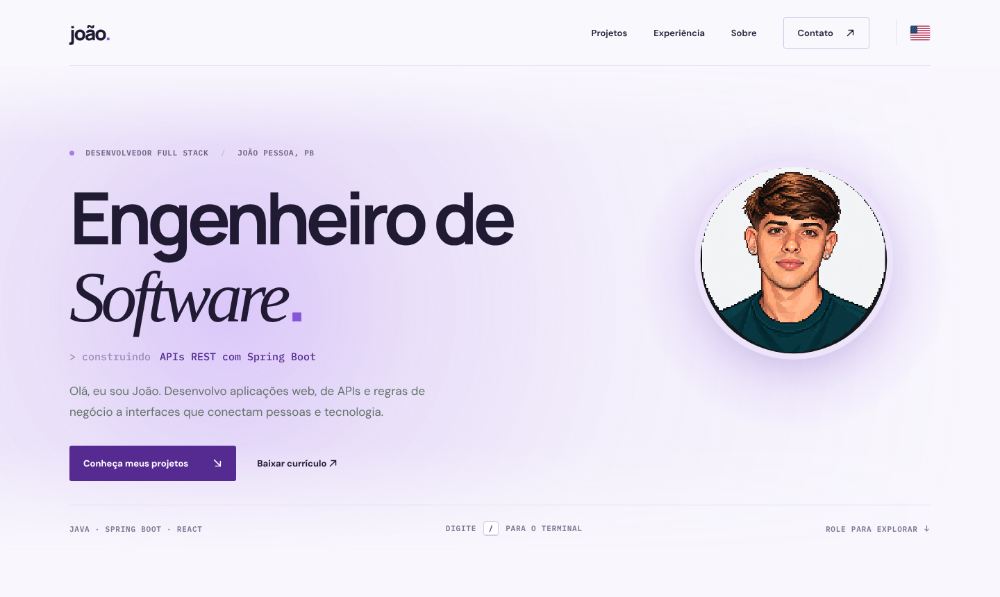

<div align="center">

# joão. — Portfólio

**Portfólio pessoal.**
Projetos, experiência e tecnologias, num site leve, animado e acessível, feito só com HTML, CSS e JavaScript.

[](https://joaoliradev-portfolio.vercel.app/)


[Português](https://joaoliradev-portfolio.vercel.app/) · [English](https://joaoliradev-portfolio.vercel.app/en.html)

<br />



</div>

## Destaques

**Movimento com propósito**
- Título que se "decodifica" ao carregar, como uma saída de terminal, e uma linha que digita e troca o que estou construindo.
- Brilho roxo que acompanha o mouse por toda a largura do hero, e botões magnéticos.
- Capturas dos projetos com inclinação 3D e reflexo; títulos revelados linha a linha e entradas alternadas.
- Seção de experiência em formato de terminal: o comando é digitado e as vagas aparecem uma a uma.
- Passar o mouse sobre uma tecnologia mostra em quais projetos ela foi usada.

**Navegação e usabilidade**
- Terminal de comandos: pressione <kbd>/</kbd> ou <kbd>Ctrl</kbd> + <kbd>K</kbd> em qualquer lugar da página.
- Cabeçalho fixo que encolhe ao rolar, barra de progresso de leitura e destaque da seção atual.
- Menu próprio para celular, botão para copiar o e-mail e hora local de João Pessoa ao vivo.
- Site em português e inglês, com troca de idioma em um clique.

**Acessibilidade**
- Respeita `prefers-reduced-motion`: com movimento reduzido, nenhuma animação roda e todo o conteúdo continua visível.
- Link para pular ao conteúdo, foco visível, `aria-current` na seção ativa e terminal de comandos operável só pelo teclado.
- Animações dependentes do mouse só são ativadas em dispositivos com ponteiro preciso.

## Terminal de comandos

Abra com <kbd>/</kbd> ou <kbd>Ctrl</kbd> + <kbd>K</kbd>, digite para filtrar, use <kbd>↑</kbd> <kbd>↓</kbd> para navegar, <kbd>Enter</kbd> para executar e <kbd>Esc</kbd> para fechar.

| Comando | O que faz |
| --- | --- |
| `projetos` · `experiencia` · `sobre` · `contato` | Vai direto para a seção |
| `cv` | Abre o currículo em PDF |
| `email` | Copia o e-mail para a área de transferência |
| `github` · `linkedin` · `instagram` | Abre o perfil em outra aba |
| `english` | Troca para a versão em inglês |
| `topo` | Volta ao início |
| `sudo contratar` | Descubra 👀 |

## Projetos apresentados

| Projeto | Descrição | Tecnologias |
| --- | --- | --- |
| [LoginAuth](https://github.com/joaolira-dev/login-auth) | Autenticação full stack com cadastro, login e JWT | Java, Spring Security, React |
| [Evoluir](https://github.com/joaolira-dev/evoluir-fullstack) | Gestão de clientes, faturas e pagamentos, com testes e documentação da API | Java, Spring Boot, React, MySQL |
| [Marketplace](https://github.com/joaolira-dev/olx-project) | Anúncios com cadastro, autenticação, busca e upload de imagens | React, Node.js, Express, MongoDB |

## Como executar localmente

Não há dependências nem etapa de compilação. Basta servir a pasta `site`:

```bash
git clone https://github.com/joaolira-dev/portfolio-v3.git
cd portfolio-v3
python3 -m http.server 8000 --directory site
```

Acesse `http://localhost:8000/` (português) ou `http://localhost:8000/en.html` (inglês).

## Estrutura

```text
.
├── site/
│   ├── index.html         # conteúdo em português
│   ├── en.html            # conteúdo em inglês
│   ├── style.css          # estilos, tema e layout responsivo
│   ├── motion.js          # animações, interações e terminal de comandos
│   ├── curriculo.pdf      # currículo disponibilizado no site
│   ├── favicon.*          # ícones do site
│   └── assets/            # ícones de tecnologias, retrato e capturas dos projetos
├── docs/                  # imagens de prévia usadas neste README
└── vercel.json            # publica a pasta site/ como site estático
```

## Como editar

- O conteúdo vive em dois arquivos, `site/index.html` e `site/en.html`. Mantenha os dois em sincronia.
- Para adicionar um projeto, copie um bloco `<article class="project">` e preencha o atributo `data-tech` com as tecnologias do projeto, usando o nome do arquivo do ícone em `assets/` (por exemplo, `java spring react`). É ele que alimenta a dica ao passar o mouse sobre cada tecnologia.
- Os comandos do terminal ficam na lista `COMMANDS`, em `site/motion.js`.
- As cores do tema são variáveis CSS (`--ink`, `--accent`, `--paper`, `--line`), definidas em `:root` no `site/style.css`.

## Publicação

O site é estático e publicado na [Vercel](https://vercel.com/). O `vercel.json` aponta `site/` como diretório de saída e desativa a detecção de framework, então cada push na `main` gera um novo deploy, sem build.

## Créditos

Ícones de tecnologias: [Devicon](https://devicon.dev/) e [Simple Icons](https://simpleicons.org/). As demais ilustrações e capturas pertencem aos respectivos projetos apresentados.

## Contato

[LinkedIn](https://www.linkedin.com/in/joaolira-dev/) · [GitHub](https://github.com/joaolira-dev) · [Instagram](https://www.instagram.com/joaoliradev/) · [E-mail](mailto:joaoliradev@hotmail.com)
